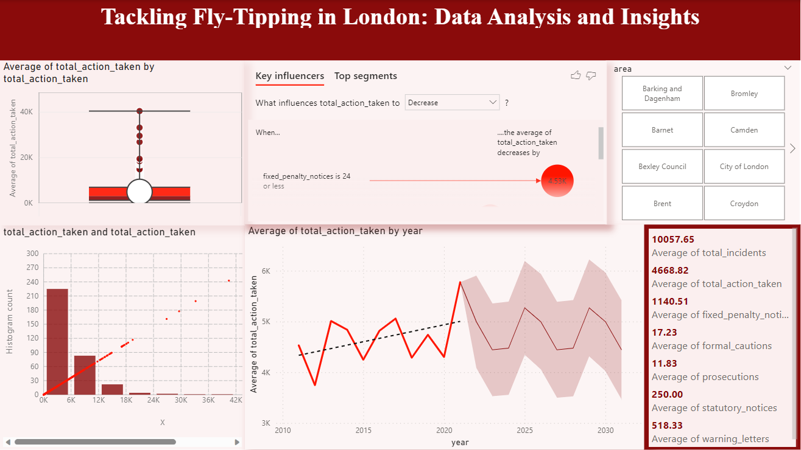
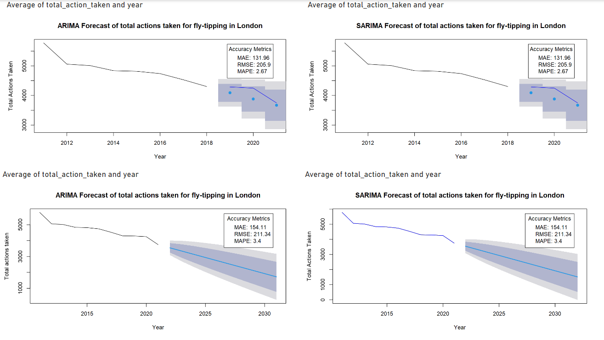

# London Fly-Tipping: enforcement dashboard and forecast

A Power BI dashboard and ARIMA forecasts of how London's councils respond to fly-tipping (illegal dumping of waste), using public data from 2011-12 to 2021-22.

**MSc Data Analytics coursework (London Metropolitan University, 2023).**



## The short version

- **Data:** 363 records from the London Datastore: 33 London local authorities (the 32 boroughs plus the City of London) × 11 years.
- **Dashboard:** incidents and enforcement actions for any borough, with a box plot, a histogram, a key-influencers visual and a trend line with forecast.
- **Forecast:** ARIMA and SARIMA models in R, run inside Power BI, projecting enforcement actions to 2031.
- **2026 check:** when I tested the 2023 forecast against the three years published since, it was 47% off. The R scripts had modelled the yearly figures in the wrong order. With the years in order, the same model is 5% off. Details [below](#2026-check-the-forecast-was-wrong).

## The data

| | |
| --- | --- |
| Source | [Fly-tipping Incidents, London Datastore](https://data.london.gov.uk/dataset/fly-tipping-incidents) (figures collected by Defra) |
| Used in the project | 2011-12 to 2021-22, 363 rows |
| Columns | area, year, total incidents, total actions taken, warning letters, fixed penalty notices, statutory notices, formal cautions, injunctions, prosecutions |

Cleaning was done in Power Query. The `injunctions` column was dropped because it is almost always 0 (it is 1 in only 4 of the 363 rows), and the year labels (2011-12) were turned into plain years.

The file in [data](data) is the current download, so it also has 2022-23 to 2024-25. The original project stopped at 2021-22.

## The forecast (2023, as submitted)

The R scripts in [r](r) are the ones behind the Power BI script visuals. Each one forecasts **average enforcement actions taken per authority**, by year.

| Script | What it does | MAE | RMSE | MAPE |
| --- | --- | --- | --- | --- |
| [arima_3yr.R](r/arima_3yr.R) | Fits on the first 80% of the series, forecasts the last 3 points | 131.96 | 205.9 | 2.67% |
| [arima_10yr.R](r/arima_10yr.R) | Fits on the whole series, forecasts 10 years to 2031 | 154.11 | 211.34 | 3.4% |
| [sarima_3yr.R](r/sarima_3yr.R), [sarima_10yr.R](r/sarima_10yr.R) | Same, with seasonality allowed | same | same | same |



The charts show enforcement actions falling steadily to about 1,700 by 2031. That conclusion was wrong, and the low error figures hid it.

## 2026 check: the forecast was wrong

In 2026 I compared the forecast with the three years of real figures published since (2022-23 to 2024-25). Run it with `python check_forecast.py`.

| | 2022-23 | 2023-24 | 2024-25 | Error (MAPE) |
| --- | --- | --- | --- | --- |
| **Actual** | 5,964 | 6,192 | 6,998 | |
| 2023 forecast | 3,544 | 3,339 | 3,135 | **47.3%** |
| Same model, years in order | 5,916 | 6,042 | 6,168 | **5.0%** |
| Baseline: repeat the last year | 5,790 | 5,790 | 5,790 | 8.9% |

Enforcement actions went **up**, not down.

**What went wrong.** The scripts build the time series with `ts(dataset$total_action_taken, start = min(dataset$year))` and never sort the rows by year. The values on the original charts start at 5,790 and fall smoothly to 3,748. Those are the eleven yearly averages ordered from largest to smallest, not from 2011 to 2021. The model learned a steady decline that was never in the data. The sorted series also reproduces the original error figures: it gives a MAPE of 3.42% on all eleven points (the report says 3.4%) and 2.70% on the first eight (the report says 2.67%). In year order the same calculation gives about 13%. In time order the series goes 4,530 → 3,748 → 5,010 → … → 5,790: bumpy, and rising overall.

**Why the error figures looked good.** `accuracy()` was called on the forecast alone, which reports error on the data the model was fitted to. A smooth, sorted series is easy to fit, so MAPE came out at 2.67% and 3.4%. Neither number says anything about years the model had not seen.

**The fix.** One line before building the series: `dataset <- dataset[order(dataset$year), ]`. With the years in order, the same kind of model (a random walk with drift, which matches the straight line on the original 10-year chart) is 5% off over the three new years, and beats the simple baseline.

**What I took from it.** Plot the series the model actually receives, and test on data it has not seen. I found the same kind of problem in my [road accident model](https://github.com/abdullah-ashrf/road-accident-severity), where 88% accuracy turned out to be a majority-class guess.

## Limits that still apply

- **ARIMA and SARIMA give the same result.** The data is yearly, so there is no season for SARIMA to find.
- **Eleven yearly points is a short series.** Any forecast from it has wide uncertainty.
- **The check uses the simplest matching model.** `check_forecast.py` reproduces the random walk with drift in plain Python. It reproduces the end points of the original charts (5,790 and 3,748, reaching about 1,700 in 2031), but it is not a re-run of the R code.
- **The R scripts in this repo are the originals**, kept as submitted so the mistake is visible. The `.pbix` forecast pages show the 2023 result.

## Files

- [powerbi/London_Fly_Tipping.pbix](powerbi/London_Fly_Tipping.pbix): the report (pages: Dashboard, Time Series Analysis, Model Evaluation)
- [r](r): the four forecast scripts, as submitted in 2023
- [check_forecast.py](check_forecast.py): the 2026 check against real figures
- [data/fly-tipping-borough.csv](data/fly-tipping-borough.csv): the source data

## Run it yourself

Open the `.pbix` in Power BI Desktop. The forecast pages need R with the `forecast` package:

```r
install.packages("forecast")
```

The report uses two custom visuals from AppSource (Box and Whisker chart by MAQ Software, and Histogram). Power BI will offer to load them when the file opens.

## Tools

Power BI · Power Query · R (forecast, ARIMA, SARIMA) · Python (2026 check)
